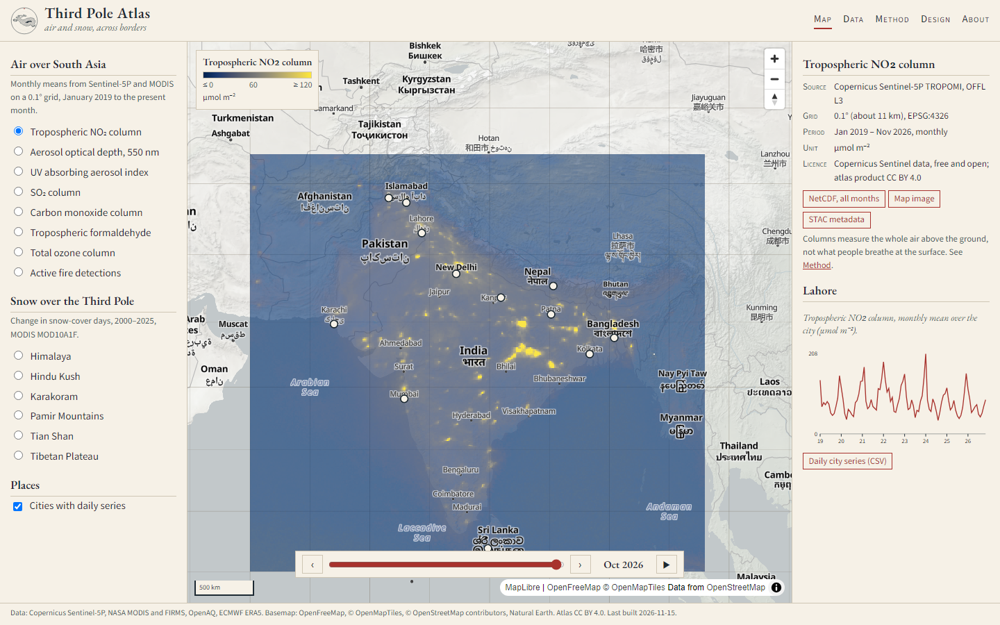

# Third Pole Atlas

Open atlas of air over South Asia and snow over the Third Pole, from open satellite data, updated to the present.
View, explore and download every layer: https://ahmadammar.github.io/third-pole/

## What is here
- `web/`: the site (MapLibre GL, OpenFreeMap basemap, static files; no server).
- `web/data/`: CF-1.8 NetCDF grids, GeoTIFFs, CSV tables and a STAC 1.0 catalogue (`catalog.json`).
- `build/build_data.py`: builds the data from [south-asia-smog](https://github.com/AhmadAmmar/south-asia-smog) and [uib-snow-cover](https://github.com/AhmadAmmar/uib-snow-cover).
- `build/build_brand.py`: the logo and social formats, computed from the Third Pole outline.
- `build/build_pages.py`: Data, Method, Design and About pages. `build/shoot.py`: screenshots for the design journal.

## Update
    python build/build_data.py && python build/build_pages.py && git commit -am "update" && git push

Data CC BY 4.0; code MIT.
